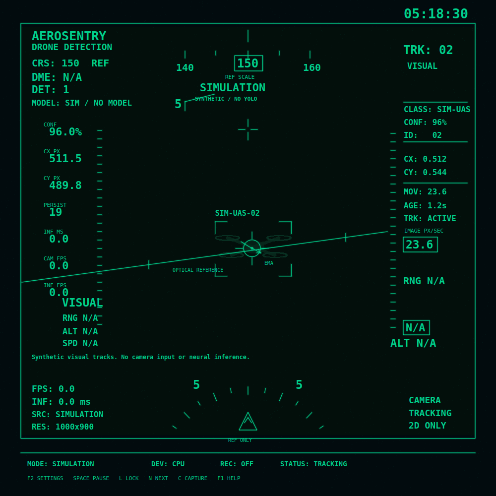

# AeroSentry — Retro Aviation HUD Drone Detection

A Python 3.12 / PySide6 desktop instrument with a custom QPainter canvas modeled on
the supplied square green-on-dark aviation display. Actual input frames pass through
Ultralytics YOLO and ByteTrack. The app has no weapon-control or physical targeting interface.



## Start on Windows 10/11 x64

1. Extract the ZIP fully into a writable folder, such as `C:\Projects\AeroSentry`.
2. Install **Python 3.12 x64** from https://www.python.org/downloads/windows/ with
   the Python Launcher enabled. Python 3.13/3.14 are not this project's tested target.
3. Double-click **install.bat**. Internet is required to install packages; PyTorch
   is a large download. The default build runs on the CPU.
4. Double-click **run.bat**. The first launch opens explicitly labeled **SIMULATION**.
5. Press **F2** or right-click the canvas to configure real input.

A real drone-trained checkpoint is **not bundled**. The program does not pretend that
simulation or a generic COCO model is a drone detector. You can inspect the complete
HUD immediately without a camera or model.

## Configure real detection

1. In **SOURCE**, uncheck **Simulation**.
2. Choose **Camera** and enter its index (`0`, `1`, etc.), **Video** and browse a
   local video, or **RTSP** and enter the stream URL. Stream credentials are not persisted.
3. Start with **cpu**, inference size **640** (use **320** on a slower CPU), and
   processing cap **10–15 FPS**. These are caps, not guaranteed performance.
4. In **MODEL / CLASSES**, browse to your trusted, local, drone-trained `.pt` file.
   Use an Ultralytics object-detection model compatible with the pinned library version.
5. Click **Read checkpoint classes**. The list comes from the checkpoint itself.
6. Leave class IDs blank to select recognized drone labels automatically, or enter
   comma-separated IDs from that exact list, such as `0,2`.
7. Set confidence / IoU thresholds and click **OK**. Model loading and inference run
   off the GUI thread. The camera opens after model validation succeeds.

Recognized drone metadata labels are listed in [models/README.md](models/README.md).
Matching a label does not verify the model's training quality. Validate precision,
recall, false positives and low-light performance on representative annotated footage.
Night-style tint only changes presentation; it cannot create thermal/night-vision data.

If a generic model is chosen with no class IDs, the app reports an incompatible model
and leaves the camera closed. Explicit general-object tracking is allowed with a
persistent compatibility warning. The actual checkpoint class remains on each target.

To use a newly released architecture, update Ultralytics in an isolated environment
and rerun tests; the shipped dependency set is deliberately pinned.

## Controls

| Key              | Action                                                 |
| ---------------- | ------------------------------------------------------ |
| F2 / right click | Settings, model and input selection                    |
| Space            | Pause/resume capture and processing                    |
| L                | Toggle selected visual target lock                     |
| N                | Cycle visible track IDs                                |
| R                | Reset tracker state and trails without reopening input |
| V                | Open source settings / reopen source                   |
| H                | Hide/show instrument graphics; mode labels remain      |
| O                | Switch LIVE OPTICAL / HUD ONLY                         |
| C                | Save screenshot                                        |
| F9               | Start/stop annotated HUD recording                     |
| F6               | Show recent SQLite events                              |
| F11              | Full screen                                            |
| Esc              | Release selected target; close a modal                 |
| F1               | Help                                                   |

Shortcuts belong to the canvas and do not capture text typed into settings fields.
Source/model changes stop the previous pipeline before opening the next one. Reopening
a video starts it from the beginning. Pausing files stops their decoder position;
network/camera drivers may buffer internally while paused.

## Read the instrument

- **Brackets:** raw YOLO box coordinates from the exact frame being displayed.
- **Circle marked EMA:** exponentially smoothed target center; it can lag the raw box.
- **Trail / arrow:** image-space history / direction estimated from successive centers.
- **MOV:** image pixels per second, using source timestamps (video frame time for files).
- **CX/CY left:** image pixels. **CX/CY right:** normalized image coordinates.
- **PERSIST:** observations for that track. **AGE:** elapsed observed source time.
- **DET:** visible detections with confirmed ByteTrack IDs; unassigned boxes are excluded.
- **CAM FPS:** capture throughput; **INF FPS:** achieved inference-result rate, not 1000/latency.
- **INF MS:** measured complete `model.track()` call, including preprocessing and tracking.
- **CRS / scales / boresight / slanted line:** explicitly configured/decorative references.
  They do not claim measured heading, attitude, range or horizon.
- **DME / range / altitude / physical speed:** N/A; no physical sensor supplies them.
- **SIMULATION:** persistent label; generated imagery/positions, zero inference telemetry.

The video is aspect-fitted within the optical frame. Both the image and every target
coordinate use the same transform. The square reference composition stays centered
when the window is wide or tall; unused margins are dark. Optical mode never stretches
the source, and HUD-only mode uses the same mapping.

The UI paints at up to ~30 FPS. **To keep overlays truthful, displayed optical frames
advance at inference cadence**, not full camera cadence. The app does not paste stale
boxes over newer camera images. CPU throughput varies with model, image size and scene.
Latest-frame mailboxes drop obsolete frames instead of building an unbounded queue.

Visual lock keeps a selected ByteTrack ID. A temporarily lost ID can be reacquired
when ByteTrack returns that ID. Long gaps, occlusion and frame skipping can produce new
IDs; there is no cross-ID re-identification claim. Press N to select a new ID. Lock
remains LOST rather than silently switching to another object.

## Output and settings

Windows default: `%LOCALAPPDATA%\AeroSentry\`

- `settings.json`: preferences; RTSP URL is deliberately blanked on disk.
- `events.sqlite3`: source, track, selection, error, screenshot and recording events.
- `screenshots\`: PNG captures of the visible instrument.
- `recordings\`: annotated MJPG AVI captures at a declared 10 FPS presentation rate.

Recording is buffered and may drop frames under overload. Recorded duration is based
on written frames, not guaranteed wall time; use source footage for quantitative timing.
Pause and simulation labels are burned into recordings. F9 stops and finalizes the AVI;
recording also stops on source changes or exit. The recorder normalizes output to 1000×1000
with aspect-preserving letterboxing.

Linux fallback: `~/.local/share/AeroSentry/`. Use `--data-dir PATH` for another directory.
The event queue is bounded to protect the GUI; disk failures are shown on the HUD.

## Command line

From the extracted `aerosentry_hud` folder in PowerShell:

```powershell
.\.venv\Scripts\python.exe main.py --simulation
.\.venv\Scripts\python.exe main.py --live --model "models\drone.pt" --source 0
.\.venv\Scripts\python.exe main.py --live --model "models\best.pt" --source "F:\pj\AeroSentry-HUD-Source\aerosentry_hud\vid\drone.mp4" --classes 0
.\.venv\Scripts\python.exe main.py --live --model "models\drone.pt" --source "rtsp://camera/stream"
.\.venv\Scripts\python.exe main.py --simulation --screenshot "preview.png"
```

`--model`/`--source` imply live mode. `--simulation` overrides them. CLI overrides are
not persisted until Settings is saved. Python entry point is `main.py` from this folder.

## Optional CUDA

Default installation uses CPU-only PyTorch. If your Windows PC has a supported NVIDIA
GPU, install the matching **torch 2.6.0 / torchvision 0.21.0** CUDA build using the
commands on https://pytorch.org/get-started/previous-versions/ in this virtual environment.
Then verify:

```powershell
.\.venv\Scripts\python.exe -c "import torch; print(torch.__version__); print(torch.cuda.is_available())"
```

Select device `0` only when availability is True. Intel UHD graphics cannot run CUDA.
The app reports a device error instead of silently claiming GPU acceleration.
CUDA has not been hardware-tested in the delivered QA environment.

## Tests

Run `test.bat`, or:

```powershell
.\.venv\Scripts\python.exe -m pytest -q
```

The optional real-model CPU smoke tests use a local generic **yolo11n.pt** and the
Ultralytics bundled bus test image. They test the software pipeline, not drones:

```powershell
$env:AEROSENTRY_TEST_MODEL = "C:\models\yolo11n.pt"
.\.venv\Scripts\python.exe -m pytest -q
```

Default tests do not download weights. See [docs/TEST_REPORT.md](docs/TEST_REPORT.md)
for the executed checks and environment limitations. A screenshot is in
[docs/hud-preview.png](docs/hud-preview.png).

## Architecture

`VideoSource` capture worker → one latest frame → `FrameProcessor` inference worker
→ one matched frame/result → `TrackStore` / `TargetManager` → `HUDWidget` QPainter.
The model is created once per pipeline and reused. A bounded recording worker and a
bounded SQLite writer keep disk activity off the UI path. Image conversion uses a
copied QImage so NumPy memory lifetime cannot corrupt the displayed frame.

Requested modules are under `ui/`, `vision/`, `services/`, and `tests/`. Coordinate
mapping is factored into `ui/coordinates.py`. There are no browser, server or cloud API
requirements. Native PySide6 is the primary UI; simulation is isolated from live capture.

## Troubleshooting

| Symptom                        | Action                                                                                                                   |
| ------------------------------ | ------------------------------------------------------------------------------------------------------------------------ |
| `py -3.12` not found           | Install Python 3.12 x64 and the launcher; rerun install.bat.                                                             |
| NumPy/torch build errors       | Use the 3.12 environment created by install.bat, not Python 3.14.                                                        |
| Missing model                  | Select an existing trusted `.pt` file; a filename alone does not download it.                                            |
| No recognized drone class      | Inspect model classes and use a drone-trained model; COCO is insufficient.                                               |
| Camera unavailable             | Close other camera apps, enable Windows camera access for desktop apps, try index 1, reopen with V.                      |
| Camera disconnects             | The HUD reports SOURCE ERROR; check connection, then V → OK to reopen.                                                   |
| Low FPS                        | Lower inference size to 320, use smaller weights, disable CRT/glow, lower the processing cap.                            |
| No boxes below a low threshold | ByteTrack also has its own activation threshold; the shipped tracker defaults require sufficiently confident detections. |
| RTSP cannot open               | Verify URL and network in your player; use an OpenCV/FFmpeg-readable stream. Open/read timeouts are configured.          |
| End of video                   | Final frame stays visible with END OF VIDEO; V → OK restarts playback.                                                   |
| Settings corrupted             | Rename settings.json in the output folder; the app falls back to simulation.                                             |
| Slow shutdown                  | Wait for inference and decoder cleanup; a stuck third-party driver can require closing again after 8 seconds.            |

Ordinary stop releases captures and finishes writers in their owner threads. A driver
that ignores OpenCV timeouts cannot be forcibly interrupted safely in-process; the
second-close fallback exits the process. Windows hardware cameras and RTSP endpoints
must be verified on the deployment machine.

## Upstream references

- Ultralytics tracking: https://docs.ultralytics.com/modes/track/
- ByteTrack configuration: https://github.com/ultralytics/ultralytics/blob/v8.3.221/ultralytics/cfg/trackers/bytetrack.yaml
- Qt QPainter: https://doc.qt.io/qtforpython-6/PySide6/QtGui/QPainter.html
- Dependency licensing: https://www.ultralytics.com/license and the respective package notices.

No pretrained weights, virtual environment, recordings or runtime logs are bundled.
